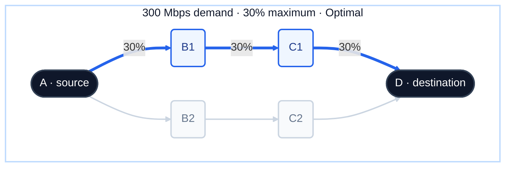
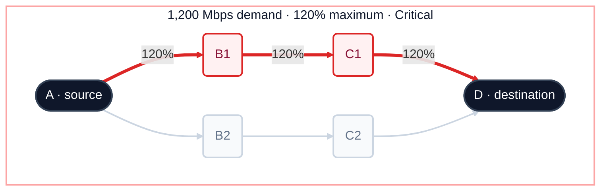
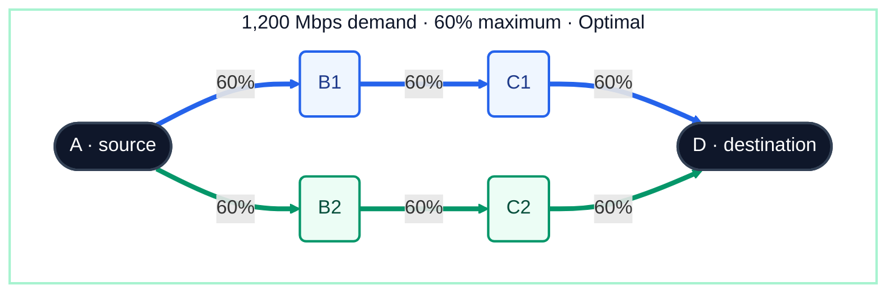
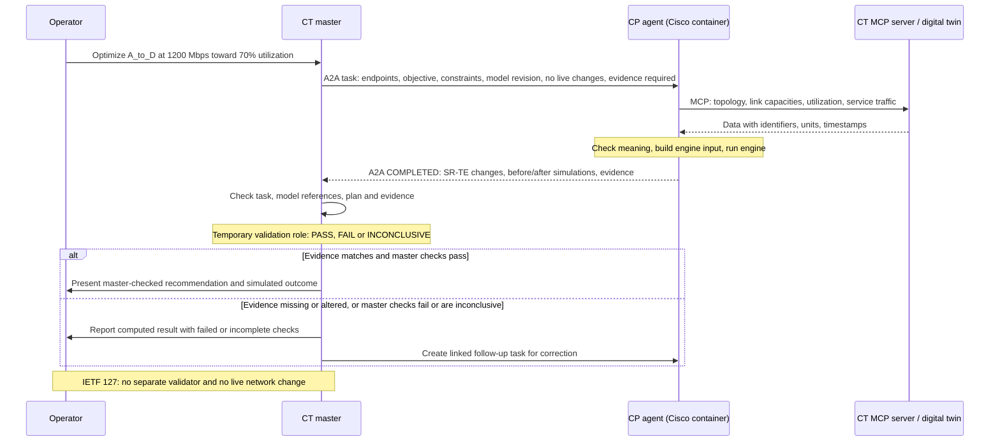

# AINETOPS IETF 127 hackathon

## In brief

China Telecom (CT) and Cisco will test whether their independently developed agents can exchange a network-planning task and understand its result and evidence. CT's master delegates the task to Cisco's capacity-planning agent (the **CP agent**) over A2A. The specialist retrieves the agreed model data through CT's MCP server, optimizes SR-TE in an isolated model copy, and returns the proposed changes with simulation evidence.

The first event lasts a day and a half. **CT's master temporarily performs the validation role at IETF 127.** A separate validation agent is planned for IETF 128. Results are described as **master-checked**, without claiming independent validation or a live-network outcome.

**Review pointer:** [Proposed wording on what the findings can establish](#proposed-wording-on-what-the-findings-can-establish) is marked for team review.

## What we will demonstrate

1. Establish a healthy model baseline with a 300 Mbps A_to_D demand.
2. Increase demand to 1,200 Mbps and simulate the resulting overload.
3. Delegate optimization toward a 70% maximum-utilization target, preserving demand and interface capacities.
4. Return the actual SR-TE changes, before/after simulation evidence, and model references.
5. Have CT's master check that result and report PASS, FAIL, or INCONCLUSIVE, separately from specialist task completion.
6. Demonstrate rejection of an unsupported traffic unit and a mismatched planning context, showing enforcement of the agreed request contract; see [step 5](#5-check-that-incompatible-requests-are-rejected).

The recorded local run reaches 60% maximum utilization. The integrated experiment must report its own actual result; it must not force that number if the model or inputs differ. Work remains on the CT-to-Cisco integration; the local lab does not by itself demonstrate the A2A/MCP exchange.

## Operator quick reference

Use the **CT master agent's chatbot** to run the demo. Send one command at a time, wait for the result, and approve planned tasks when prompted. The master delegates the planning work to the CP agent. The results below are the recorded local reference; report the integrated run's actual results.

| Step | Command or input | What to show the audience |
| --- | --- | --- |
| 1 | `change demand A_to_D traffic to 300` | Confirmation that the model demand is now 300 Mbps. |
| 2 | `list demand` | `A_to_D`, source A, destination D, traffic 300 Mbps. |
| 3 | `run simulation` | Healthy baseline: 30% maximum utilization and reported health **Optimal**. |
| 4 | `change demand A_to_D traffic to 1200` | Confirmation that demand is now 1,200 Mbps; interface capacities remain unchanged. |
| 5 | `run simulation` | Overloaded baseline: 120% modeled utilization, three interfaces above 100%, and reported health **Critical**. A successful simulation can report an unhealthy network. |
| 6 | `lower utilization to 70% with details` | Review and approve the proposed analysis steps. Show the SR-TE changes and re-simulation: the recorded run reaches 60% maximum utilization while retaining 1,200 Mbps demand and 1,000 Mbps interface capacities. |
| 7 | Run the two rejection checks in [section 5](#5-check-that-incompatible-requests-are-rejected). | Show rejection of an unsupported traffic unit and a mismatched planning context. |

## The problem being tested

The [AINETOPS problem statement](https://github.com/dan-voyer/IETF/blob/main/AINETOPS-proposal/draft-xxx-ainetops-problem-statement-00-v1.md) identifies task and evidence models as candidate interoperability concerns (R-5 and R-6). This experiment records what the two implementations can understand using existing mechanisms and the agreed application contract, and what needs additional agreement. It covers agent-to-agent task/result exchange; agent lifecycle, intervention, and independent validation are outside this first event.

### Who provides what

| Component | Provided by | Role |
| --- | --- | --- |
| Master agent | CT | Delegates the task over A2A, checks the returned plan and evidence, and presents the result; temporarily performs the validation role |
| MCP server | CT | Read-only topology, telemetry, and link performance from the digital twin |
| Digital twin (emulator) | CT | Emulates the test network. No live network is touched. |
| CP agent, MCP client and data adapter | Cisco, one Docker container | Accepts the task, fetches data, builds the engine input, returns the result and evidence |
| Planning engine | Cisco | Optimizes SR-TE paths and weights in an isolated model, then re-simulates utilization. Confirm its APIs first. |

The working assumption is CT's platform in CT Cloud and the Cisco container on AWS, over public IPs. CT initiates A2A; the CP agent initiates MCP. An alternative, still to be agreed, is CT's master and digital twin in a Cisco lab over VPN. Run the full exchange end to end before the event.

### The scenario: from an overloaded path to a balanced SR-TE plan

The demo starts with a small IPv6 planning model: six nodes, six circuits, twelve interfaces, one traffic demand named `A_to_D`, and two existing Segment Routing LSPs, `Tunnel100` and `Tunnel200`. Every interface has a configured capacity of **1,000 Mbps**. The two branches are A → B1 → C1 → D and A → B2 → C2 → D.

**Reading the diagrams:** each interface in this lab model is configured with **1,000 Mbps (1 Gbit/s) capacity**. Arrows show A-to-D traffic direction; percentages reproduce the simulation's reported forward-interface utilization. Gray links have no utilization value listed in the baseline simulation summary; they do not mean zero traffic or a failed path. The topology and node positions stay the same in all three drawings.

#### 1. Establish a healthy baseline

After loading the lab plan, the operator asks: **“change demand A_to_D traffic to 300”**, then **“list demand”**. The agent confirms that demand A_to_D runs from A to D at **300 Mbps**. Listing the demand makes the input visible before evaluating the network.

The operator then asks: **“run simulation”**. The simulation reports **Optimal** network health and a maximum interface utilization of **30%**. The three loaded forward interfaces—A/GigabitEthernet1, B1/GigabitEthernet2, and C1/GigabitEthernet2—each show 30% utilization, consistent with 300 Mbps using the A → B1 → C1 → D branch.

#### Diagram 1 — Healthy baseline



*The first simulation establishes a healthy baseline: three forward interfaces on A → B1 → C1 → D report 30% utilization.*

#### 2. Increase demand and expose the bottleneck

Next, the operator asks: **“change demand A_to_D traffic to 1200”**, then runs the simulation again. The demand is now **1,200 Mbps**, while each interface still has only 1,000 Mbps of capacity.

The simulation completes successfully, but reports the network as **Critical**: maximum utilization is **120%**, with three interfaces above 100%. The overloaded interfaces are the same three on the first branch. Here, 120% represents modeled offered load relative to capacity; it does not mean that a physical 1,000 Mbps interface is forwarding 1,200 Mbps.

This is the first important distinction in the demo: **a successful simulation task can report an unhealthy network**. Task success describes whether the analysis ran; the result describes whether the network meets its requirements.

#### Diagram 2 — Demand exceeds path capacity



*Demand has increased fourfold. The same three interfaces now report 120% modeled load, exceeding their capacity.*

#### 3. Ask for a better plan

The operator asks: **“lower utilization to 70% with details”**. The agent presents a four-step plan for approval: run a baseline simulation, optimize SR-TE bandwidth, re-run the simulation, and retrieve the resulting summary and detailed change report. As in the preceding steps, the operator approves the planned tasks before execution.

The optimizer works on the planning model. It does not reduce the traffic demand or change interface capacity. The detailed report shows **two existing LSPs rerouted**, **two new weighted segment lists**, **no new LSPs**, and **no modified demands**. It also reports zero latency-bound violations; that counter alone does not establish a latency guarantee, especially where no bound is configured.

The detailed LSP report identifies the changes as follows. These are the UI's segment-list summaries, not expanded physical hop lists.

| LSP | Before route information | After segment-list summary |
| --- | --- | --- |
| Tunnel100 | B1 → C1 → D | `SL (1.0): D` |
| Tunnel200 | B1 → C1 → D | `SL[1] (1.0): B2 → D` |

#### 4. Re-simulate and show the outcome

The final simulation reports **60% maximum utilization**, below the requested 70% target. All six forward interfaces across the two branches show 60% utilization. The report demonstrates a balanced modeled load while retaining the 1,200 Mbps demand; per-branch throughput is not separately reported in the simulation summary. No interfaces remain above 100% or above the report's 80% critical threshold, and network health changes from **Critical** to **Optimal**.

#### Diagram 3 — Traffic balanced after optimization



*The optimized simulation reports 60% on all six forward interfaces. Demand stays at 1,200 Mbps; the requested 70% target is met.*

| Stage | Demand A_to_D | Maximum utilization | Interfaces above 100% | Reported health |
| --- | --- | --- | --- | --- |
| Initial baseline | 300 Mbps | 30% | 0 | Optimal |
| Increased demand, before optimization | 1,200 Mbps | 120% | 3 | Critical |
| After SR-TE optimization and re-simulation | 1,200 Mbps | 60% | 0 | Optimal |

The planning sequence ends with the before/after comparison and LSP change details. **70% is the requested target; 60% is the achieved simulation result.** The change from 120% to 60% is a reduction of 60 percentage points, or 50% relative to the baseline. The UI's “Optimal” label is a reported health classification, not proof of a globally optimal solution.

Retain the demand values, model versions, LSP changes, and before-and-after simulation results as evidence. The results should show that the 1,200 Mbps demand remains unchanged while maximum interface utilization falls from 120% to 60%, below the requested 70% target. Include the detailed routes and traffic-distribution weights where needed to explain and validate the improvement.

#### 5. Check that incompatible requests are rejected

The successful planning run shows what happens when the request and planning context agree. Two deliberately injected errors, exercised in the local CP-agent interface, show how the implementation responds when they do not. These are contract checks, not failures of the SR-TE optimizer; they do not by themselves demonstrate the integrated CT-to-Cisco exchange.

**Presenting the checks through CT's master:** confirm that its chat integration forwards the `prompt` and `constraints` fields unchanged to the CP agent. Pasting JSON as chat text alone does not establish that these fields are forwarded. If that forwarding is unavailable, demonstrate the checks in the CP-agent interface and identify them as local checks. Preserve the incompatible inputs rather than silently correcting the unit or substituting the active plan key.

**Test A — unsupported traffic unit**

Submit this structured input:

```json
{
  "prompt": "change demand A_to_D traffic to 1200",
  "constraints": {
    "demand_traffic_unit": "percent"
  }
}
```

**Observed response:** `input_invalid`; the input schema requires `Mbps` for `constraints.demand_traffic_unit`. The value 1,200 alone is not enough to define a traffic demand; the unit must also be understood.

This can happen when one agent expresses utilization as a percentage while another expects an absolute traffic rate, or when an adapter maps a field incorrectly. A percentage also needs a reference capacity before it can be translated into a rate. Rejecting the unsupported unit avoids silently treating the request as 1,200 Mbps. This check catches an explicit unit incompatibility; it does not establish that schema-valid values have the same meaning on both sides.

**Test B — wrong planning context**

Submit this structured input:

```json
{
  "prompt": "run simulation",
  "constraints": {
    "expected_plan_key": "{00000000-0000-0000-0000-000000000000}"
  }
}
```

**Observed response:** `TASK_STATE_REJECTED` with `constraint_rejected`, explaining that the expected plan key does not match the active CP plan. The all-zero key is a deliberately non-matching test value, not a key to use for normal planning.

In a multi-agent workflow, this could happen after a plan switch, a delayed request, or reuse of a reference from another session. A simulation may run correctly yet answer the wrong question if it uses a different plan. The check binds the request to the intended planning context. A matching plan key alone does not establish that the model revision is unchanged or that a returned report belongs to that revision.

For each rejection, retain the request and response. Use the tool trace or model state to confirm that the rejected request did not perform the requested operation, then repeat with `Mbps` or the actual active plan key and record the outcome. The screenshots establish rejection responses; those additional records establish the effect of rejection.

**Why this matters:** exchanging a readable message is only the first step. The receiving implementation must enforce the agreed units and planning context, and explain an incompatibility rather than guess. These tests give the hackathon concrete examples of which contract details must be shared across implementations.

## Multi-agent workflow

CT's master delegates the overloaded-model task. The specialist may edit an isolated model copy and re-simulate alternatives, but has no authority to deploy live-network changes. The master checks the returned plan and supporting evidence using the checks below. Completing a specialist task, meeting the utilization target, passing master checks, and deploying a plan are separate outcomes.



## Required result from the specialist

Return **the proposed SR-TE changes**, not just counts of rerouted LSPs or a utilization summary. The result must contain, directly or through an accessible agreed artifact:

- The CT and A2A task IDs, engine run ID, and input/output model revisions.
- Each changed LSP's identity, original and proposed segment lists, segment identifiers and weights, with route resolution and demand-to-LSP mapping available for inspection.
- The affected interface identities, unchanged capacities, and simulated before/after utilization.
- The baseline and optimized simulation reports and the engine's detailed change output.

The master must be able to inspect the artifact in the agreed format without a separate explanation from an engineer. The local display's short segment-list summaries do not replace that artifact. The exact fields and representation belong in the implementation contract; see the [change-artifact reference](AINETOPS-IETF127-Technical-Reference.md#result-artifacts-and-the-proposed-sr-te-changes).

## Minimum checks by CT's master

For IETF 127, the master checks the returned result and evidence. It does not need to become a second planning engine. Agree the required checks before the event and record their outcomes separately.

| Required check | What the master checks |
| --- | --- |
| Task and model match | Task IDs, A_to_D scope, 70% target, units, and input/output model references match the delegated task and returned artifacts. |
| Actual plan available | The change artifact is accessible and identifies the affected LSPs, proposed segments/weights, and referenced routing details. Counts alone are insufficient. |
| Demand and capacity preserved | Referenced input/output data supports unchanged 1,200 Mbps demand and configured interface capacities; do not rely only on an `unchanged: true` assertion. |
| Result supported | Baseline and optimized reports belong to the same planning operation and support the reported per-interface utilization and change summary. |
| Target assessment | Compare reported optimized maximum utilization with the requested 70% target. Target satisfaction is recorded separately from task completion; it is not inferred from `COMPLETED` or an “Optimal” label. |
| Model consistency | Changed LSPs, segments and interfaces resolve in the referenced model; record the available demand-binding and reachability checks and any claims the master cannot verify. |

**PASS:** all agreed required checks have supporting evidence and pass. **FAIL:** evidence demonstrates a required-check violation. **INCONCLUSIVE:** evidence is missing, inaccessible, or insufficient, or the master cannot perform a required check. A computed result may be well documented while missing its target; the master must report that outcome explicitly and must not present it as meeting the task's requirements.

The master records its identity, check methods, evidence references, per-check outcomes, and unchecked claims. Call the recommendation **master-checked** only when the agreed required checks pass. This does not establish independent recomputation, configuration execution, or a live-network improvement.

## Scope and success criteria

| Scope | Work |
| --- | --- |
| Prepare | Confirm endpoints, authentication, protocol versions, application contract, model references, engine access, accessible artifacts, and the master's required checks. Keep credentials outside the repository. |
| Core | One end-to-end A2A task with MCP data retrieval, SR-TE optimization/re-simulation, an inspectable change artifact, and a master check record. |
| Core checks | Reproduce the lab progression and distinguish a completed specialist task from a result whose master checks fail or remain inconclusive. Investigate organic integration mismatches if they arise; no mismatch is a valid finding. |
| Core output | A reproducible exchange, the task/result contract and mappings, proposed changes and evidence, the master's check record, and a short findings report. |
| Stretch | Independent contract consumer; additional status, semantic, evidence-binding or changed-snapshot tests; isolated emulator execution and traffic measurement. These are not required for the first demonstration. |
| Deferred | Separate validation agent, planned for IETF 128; lifecycle, intervention/recovery, live ingestion, production authorization tests, and live-network changes. |

The existing local scenario is the baseline demonstration, not a benchmark of the planning engine. Retain the distinction between specialist computation, master checks, and any later device execution.

## Proposed wording on what the findings can establish

> **Proposal for review:** The hackathon will document which task, result, and evidence meanings the two implementations exchange successfully, what additional agreements are required, and how those agreements are represented. Findings will distinguish implementation or configuration issues, reusable application profiles or mappings, and candidate specification gaps. Additional integration effort alone does not establish a standards gap. Where existing mechanisms and the documented contract are sufficient, that is a positive result. The report may inform AINETOPS and related work, but one integration does not establish an industry-wide requirement for a new protocol, profile, or working group.

Record whether each finding arose during integration or was deliberately injected. For candidate gaps, identify the conflicting interpretations, operational consequence, existing mechanisms considered, and whether another implementation could reuse the resolution without bilateral clarification. Detailed reporting guidance is in the [technical reference](AINETOPS-IETF127-Technical-Reference.md#making-the-findings-credible).

## Remaining coordination

- Confirm hosting and connectivity, data handling, and the specialist's LLM access where used.
- Confirm the application contract and CT status mapping, including the distinction between specialist completion and master checks.
- Use the agreed MCP input specification; confirm model-reference consistency between master and specialist.
- Confirm accessible SR-TE change artifacts, check methods, and PASS/FAIL/INCONCLUSIVE handling.

## Supporting material

- [Technical reference](AINETOPS-IETF127-Technical-Reference.md): task/status/evidence mappings, illustrative A2A request, change-artifact requirements, reporting guidance, production considerations, and background references.
- Implementation notes, the detailed test plan, negotiation log, and expected-findings records remain preparation artifacts to complete or upload. The agreed MCP input specification is not duplicated here.
