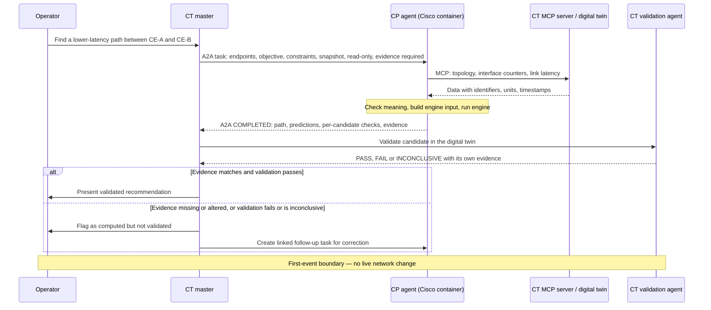

# AINETOPS IETF 127 hackathon

## In brief

This is a plan for a day-and-a-half experiment at the Internet Engineering Task Force (IETF) 127 hackathon. China Telecom (CT) and Cisco will test whether their independently developed agents can work together on a network-planning task. CT's master agent asks a Cisco-built capacity-planning agent (the "CP agent") to find a better network path. The master agent sends the request using Agent2Agent (A2A). The CP agent reads network information from CT's digital twin using the Model Context Protocol (MCP), runs a planning engine, and returns a recommendation with evidence.

The experiment tests whether both implementations understand the task, its status, and its supporting evidence the same way. It records what CT and Cisco still need to agree on beyond A2A and MCP. The findings can inform AINETOPS and related standards discussions without presuming that a new protocol, profile, or working group is needed. Existing specifications proving sufficient is a valid outcome.

## What happens during the hackathon

1. **Agree on the test.** CT and Cisco pin a digital-twin snapshot and define the request: find a path that meets the agreed latency, bandwidth, and reachability requirements.
2. **Delegate the task.** CT's master agent sends the request to the CP agent over A2A.
3. **Compute a recommendation.** The CP agent retrieves the agreed network data through MCP, runs the planning engine, and returns its recommended path and evidence.
4. **Check the recommendation.** CT's validation agent checks the candidate against the digital twin and reports PASS, FAIL, or INCONCLUSIVE.
5. **Report what the evidence supports.** The master presents a path as validated only when the evidence matches and validation passes. Otherwise, it reports that the path was computed but not validated.

For this experiment, CT provides an emulated test network. The experiment's main output is a record of what the two implementations could understand from the protocols and agreed contract, what needed further agreement, and what remains unresolved.

## The problem it tests

The [AINETOPS problem statement](https://github.com/dan-voyer/IETF/blob/main/AINETOPS-proposal/draft-xxx-ainetops-problem-statement-00-v1.md) ([PDF](https://github.com/dan-voyer/IETF/blob/main/AINETOPS-proposal/AINETOps%20Problem%20Statement.pdf)) states that multi-agent interoperability could fail not because of any lack of connectivity or transport, but because there is no shared **task model** or **evidence model** (R-5 and R-6).

The v2 discussion deck (*AINETOPS-Problem-Statement-v2-with-diagrams*, 29 September 2026) narrows this to two candidate standards outputs:
**A. agent operational lifecycle** and
**B. a network task and evidence profile** that reuses generic task protocols such as A2A.

A key distinction is whether an operation was accepted, a task was completed, or the intended network outcome was verified. Those claims require different evidence.

This hackathon is an attempt to test the feasibility of (B) by prototyping. It may find that existing mechanisms and documented mappings are sufficient. Or it may identify areas where we may need additional work.

CT and Cisco built their agents independently. CT already has its own task and evidence model.

| Problem area (v2 deck) | Covered here? |
| --- | --- |
| B. Task and evidence profile, agent-to-agent | **Yes, the core of the event** |
| Acceptance versus result versus verified outcome | **Partly.** Accepted, computed, and validated in the digital twin are core. Applied and re-measured is a stretch goal. |
| B. Task and evidence profile, agent-to-controller | Only through the stretch goal. The deck's main example sits at this boundary. |
| A. Agent operational lifecycle | No. Agent registration is bypassed. |
| Intervention and recovery (with ICON) | No |
| Risk classification | Only as the task's read-only mode. The v2 deck drops a universal R0–R5 scale as an initial requirement. |

The hackathon tests the real problem, but only its agent-to-agent half. The gap report must say what was not covered.

## Start with the demo

### Who provides what

| Component | Provided by | Role |
| --- | --- | --- |
| Master agent | CT | Delegates the task over A2A, presents the result |
| Validation agent | CT | Checks the recommended path in the digital twin |
| MCP server | CT | Read-only topology, telemetry, and link performance from the digital twin |
| Digital twin (emulator) | CT | Emulates the test network. No live network is touched. |
| CP agent, MCP client and data adapter | Cisco, one Docker container | Accepts the task, fetches data, builds the engine input, returns the result and evidence |
| Planning engine | Cisco | Computes candidate paths with latency and available bandwidth. Confirm its APIs first. |

The working assumption is CT's platform in CT Cloud and the Cisco container on AWS, over public IPs. CT initiates A2A; the CP agent initiates MCP. An alternative, still to be agreed, is CT's master and digital twin in a Cisco lab over VPN. Run the full exchange end to end before the event.

### The scenario: latency-aware path planning under capacity constraints

CE-A in metro domain A connects to CE-B in metro domain B across an IS-IS level-2 core. CT's platform learns the twin's topology through BGP-LS.

| Path | Route | Latency |
| --- | --- | --- |
| P1, current | CE-A → PE-A → E1-A → I1-B → PE-B → CE-B | 100 ms |
| P2 | Alternative path through the core | 25 ms |
| P3, candidate | CE-A → PE-A → E3-A → I3-B → PE-B → CE-B | 12 ms |

This first use case is latency-aware path planning under capacity constraints. P1 breaches the service's latency objective. The master asks for a path that meets the objective, has enough spare bandwidth, and keeps the VPN reachable. The expected answer is P3, which needs to be confirmed by CT's validation agent.

For the baseline fixture, agree a maximum one-way latency of 20 ms and pin the topology, traffic, routing assumptions, and measurement window. P2 fails that latency constraint; P3 is the expected answer only if the fixture also demonstrates sufficient bandwidth and VPN reachability. Record those values before the run. The numbers are illustrative until CT and Cisco approve the fixture. Modified inputs may correctly produce another path or no feasible path; the test must never force P3 regardless of the data.

Define available bandwidth before approving the fixture: measured spare capacity, unreserved bandwidth, and a policy-limited estimate are different quantities. Record the chosen definition, traffic direction, measurement window, and how link values determine path availability. Carry the definition in the contract or referenced snapshot metadata; a numeric value and unit alone are insufficient.



### Data retrieval and validation

#### Data retrieval

- The CP agent retrieves topology, traffic, and latency data from CT's MCP server.
- If CT's master agent performs discovery first, it passes the snapshot ID to the CP agent. The CP agent must use that same snapshot.
- Agree how the MCP server provides a consistent snapshot across data sources. If it cannot, record the source timestamps and limitations.
- The CP agent must not produce a recommendation when required inputs are missing or too inconsistent to support the requested checks.

#### Validation

CT's validation agent checks the proposed path against the agreed constraints and a compatible digital-twin state. For the core event, validation is a simulation or model check; it does not apply a configuration or measure live traffic.

The validation result includes:

- `PASS`, `FAIL`, or `INCONCLUSIVE`
- The validation method and digital-twin state used
- Predicted latency, available-bandwidth, and reachability checks
- Evidence linked to the task, candidate path, and constraints

The master may call a recommendation validated only when the result is `PASS` and its evidence matches the planning result. Otherwise, it reports the recommendation as computed but not validated.

Applying a path in the digital twin and measuring it afterward is stretch scope. If the event includes that work in its core validation, agree on the change before the event and update the scope accordingly. Neither simulated validation nor digital-twin measurement establishes a live-network outcome.

## Technical reference: task and evidence model

This is the heart of the hackathon. The path computation is the vehicle; the task and evidence around it are what we test. Work out these tables with CT before the event and keep a [negotiation log](#the-negotiation-log-is-the-primary-evidence) while doing it; the event then checks that the agreed mapping works.

CT's existing model (slide *Task Model / Evidence Model in Configuration Generation*) has these task fields: `Task_id`, `Type`, `Goal`, `Target`, `Mode` (for example `PLAN (READ_ONLY)`), `Window`, `Current-step`, `Current-Job`, `Process_flow`, `Status`, `Exist_reason`, `Check_point`, `Device`, `Process_result`, `Output`. Its evidence is `dict(step, JSON)`, used today only in the validation stage. CT should confirm whether these fields are what its platform implements or an illustration for the configuration-generation use case. The spelling `Exist_reason` is retained from the supplied model; confirm whether the implemented field is `Exist_reason` or `Exit_reason` before finalizing the mapping.

### Carry a versioned network contract in A2A

Use a versioned planning request/result contract carried in standard A2A 1.0 message data parts and result artifacts. This hackathon does not define or negotiate an A2A protocol extension. Agree the application contract identifier, supported versions, required fields, and unsupported-version behavior before testing. The JSON examples below identify that contract through `contract: "latency-planning/v1"` inside the application data.

Before integration, express the application request and result contract as versioned JSON Schema, with required fields, units, error outcomes, and unsupported-version behavior. Pair it with an approved input fixture and expected results, including a no-feasible-path case. Schema validation checks structure; semantic checks still require documented definitions and fixture evidence. These are preparation deliverables, not artifacts already supplied by this document.

The useful finding is which network semantics required an additional agreement, whether existing models already define them, and whether the issue is network-specific or generic. For each field below, distinguish the core A2A carrier from our application-defined meaning. Document that meaning in the request/result contract and record any remaining out-of-band agreements.

### Task model

| What the task must say | CT field | Where A2A 1.0 carries it | What must be agreed |
| --- | --- | --- | --- |
| Identity | `Task_id` | Core: task ID, context ID | Map CT’s ID to the specialist’s server-assigned A2A task ID; evidence cites both. Context ID groups interactions and is not a task ID |
| Kind of task | `Type` | Agent Card advertises skills; request data identifies our operation | Skill and operation mapping; the card alone does not select a per-request operation |
| Objective | `Goal` | Core: message text or structured data part; objective semantics are application-defined | A structured objective, and what "latency" means (measured or propagation, one-way or round trip, window) |
| Network scope | `Target`, `Device` | Application contract in a data part; content not defined by A2A | How nodes, links, and endpoints are named on both sides, for example [RFC 8345](https://www.rfc-editor.org/info/rfc8345) IDs |
| Constraints | Inside `Goal`? | Application contract in a data part | Latency, bandwidth, and reachability, with units |
| Authority | `Mode` | Application contract; permissions enforced by platform/tool access controls | How read-only is stated, and who enforces it |
| Time validity | `Window` | Application contract in a data part | Task validity or data measurement window? |
| Input data | Not present | Application contract in a data part | Which snapshot to use |
| Progress | `Process_flow`, `Current-step`, `Check_point` | Status message, history | Whether a sub-agent reports steps, and whether CT's human check points apply to it |
| Why it ended | `Exist_reason` | Status message | Reasons that separate "no feasible path" from bad input or engine error |
| Output | `Process_result`, `Output` | Artifacts | Result structure, kept separate from evidence |

### Task status

CT's status values and A2A's task states do not line up one to one. A2A 1.0 explicitly rejects `TASK_STATE_RUNNING`; its equivalent is `TASK_STATE_WORKING`.

| CT status | Closest A2A 1.0 state | What must be agreed |
| --- | --- | --- |
| `RUNNING` | `WORKING` | A rename, but the names are not shared |
| `WAITING` | `INPUT_REQUIRED`, `AUTH_REQUIRED`, or `SUBMITTED` | Waiting for whom? |
| `END` | `COMPLETED` | Computed, or validated? |
| `ERR` | `FAILED` | Is "no feasible path" an error or a completed negative answer? |
| `EXIT` | `CANCELED`? | How it differs from `END` and `ERR` |
| No equivalent | `REJECTED` | How CT shows a sub-agent refusing a task |

### Outcome layers

For this planning contract, the CP agent's `TASK_STATE_COMPLETED` means it finished the requested analysis, including a legitimate no-feasible-path answer. This is our task-specific completion criterion, not A2A's universal definition. The master reports the highest outcome layer actually reached and never infers a higher one. State names abbreviated in the tables use the `TASK_STATE_` prefix on the A2A 1.0 JSON wire.

A completed, failed, canceled, or rejected A2A task is terminal. Correction or replanning after completion creates a new task, linked to the prior task using `referenceTaskIds` and, where appropriate, the same `contextId`. Do not send a correction as another message on the completed task. The overall CT workflow may remain open while the specialist's individual task is complete.

| Layer | Reported by | In this event |
| --- | --- | --- |
| 1. Accepted | CP agent: `SUBMITTED` or `WORKING` | Core |
| 2. Computed | CP agent: `COMPLETED` with result and evidence | Core |
| 3. Validated (predicted) | CT validation agent: only PASS with matching evidence reaches this layer; FAIL or INCONCLUSIVE does not | Core |
| 4. Applied | Controller function in the twin | Stretch |
| 5. Verified outcome | Fresh measurement in the twin | Stretch |

### Evidence model

The fields combine R-6 (provenance, confidence, trace context, verification) with the v2 deck (source, time, scope, operation reference, verification result). Two parties produce evidence for one task; the master combines them for the operator.

| Field | CP agent's evidence | CT validation agent's evidence |
| --- | --- | --- |
| Task reference | A2A task ID and CT `Task_id` | Same IDs, plus its own step |
| Source | CP agent's authenticated identity | Validation agent's identity |
| Time | Snapshot collection times, run time | Validation run time and input-state time |
| Scope | CE-A to CE-B; candidates P1, P2, P3 | P3 |
| Inputs | Snapshot IDs retrieved over MCP | Compatible twin state ID, same candidate and constraints; explain any state differences |
| Operation reference | Engine operation, parameters, run ID | Simulation ID |
| Result | Per-candidate latency and bandwidth checks, including why P2 fails | Simulated/predicted latency, available-bandwidth, and reachability checks for core; fresh probe measurements only if the stretch execution runs |
| Verification | Engine-backed prediction with traceable output; not independently validated | PASS, FAIL, or INCONCLUSIVE, with method and checks performed |
| Limitations | Model prediction and assumptions | Twin/model validation; record shared assumptions and limits of independence |
| Access | Reference to full engine output, and who may read it | Reference to full simulation output |

Also agree: whether evidence travels in a separate A2A artifact, within the result artifact, or by accessible reference; one package per task or per step (CT uses per step); and how the master builds one view from both. A structured record with saved logs is enough; no new provenance protocol or attestation is needed.

### Illustrative A2A request and result

These are illustrative A2A 1.0 HTTP+JSON message bodies, not captured traffic or a complete application schema. The request uses `POST /message:send`, `Content-Type: application/a2a+json`, and `A2A-Version: 1.0`. Other A2A bindings have different envelopes. Fields inside each `data` object belong to our proposed planning contract, not the A2A core specification. The 10 Gbit/s requirement and other fixture values below are examples to agree with CT.

The first request omits `taskId`: the specialist assigns its A2A task ID. `ctTaskId` preserves the master's correlation ID.

```json
{
  "message": {
    "messageId": "msg-plan-001",
    "role": "ROLE_USER",
    "parts": [{
      "data": {
        "contract": "latency-planning/v1",
        "ctTaskId": "CT-001",
        "operation": "propose-path",
        "endpoints": {"source": "CE-A", "destination": "CE-B"},
        "objective": {"metric": "one-way-latency", "maximum": 20, "unit": "ms"},
        "constraints": {
          "minimumAvailableBandwidth": {"value": 10, "unit": "Gbit/s"},
          "preserveVpnReachability": true
        },
        "input": {
          "snapshotId": "twin-snapshot-001",
          "windowStart": "2026-10-22T10:00:00Z",
          "windowEnd": "2026-10-22T10:05:00Z"
        },
        "authority": "recommendation-only",
        "requiredEvidence": ["input-references", "engine-run", "candidate-checks"]
      }
    }]
  }
}
```

An illustrative final response follows. Its available bandwidth and reachability values are assumed fixture outputs, not measured facts. The engine evidence supports a computed result; validation is still pending. A real implementation must retain accessible engine inputs and outputs and define authentication, evidence access, error outcomes, and schema validation.

```json
{
  "task": {
    "id": "cp-task-001",
    "contextId": "context-001",
    "status": {"state": "TASK_STATE_COMPLETED"},
    "artifacts": [{
      "artifactId": "planning-result-001",
      "parts": [{
        "data": {
          "contract": "latency-planning/v1",
          "ctTaskId": "CT-001",
          "outcome": "feasible",
          "candidateId": "P3",
          "path": ["CE-A", "PE-A", "E3-A", "I3-B", "PE-B", "CE-B"],
          "checks": {
            "predictedOneWayLatency": {"value": 12, "maximum": 20, "unit": "ms", "pass": true},
            "availableBandwidth": {"value": 15, "minimum": 10, "unit": "Gbit/s", "pass": true},
            "vpnReachability": {"predicted": true, "pass": true}
          },
          "rejectedCandidates": [{
            "candidateId": "P2",
            "reason": "latency-exceeds-maximum",
            "predictedOneWayLatency": {"value": 25, "unit": "ms"}
          }],
          "evidence": {
            "a2aTaskId": "cp-task-001",
            "ctTaskId": "CT-001",
            "snapshotId": "twin-snapshot-001",
            "engineRunId": "engine-run-001",
            "operation": "constrained-path-computation",
            "parametersRef": "evidence://engine-run-001/parameters",
            "outputRef": "evidence://engine-run-001/output",
            "runTime": "2026-10-22T10:06:00Z"
          },
          "validation": {"status": "pending"}
        }
      }]
    }]
  }
}
```

The `evidence://` references are placeholders for an agreed, resolvable evidence store; A2A does not define that URI scheme. The authenticated connection establishes the specialist's identity. CT's validator adds its own evidence, including method, state reference, constraint checks, and PASS/FAIL/INCONCLUSIVE. A correction message uses a new `messageId`, `referenceTaskIds: ["cp-task-001"]`, and optionally `contextId: "context-001"`; omit the old `taskId` so a new task can be created. A legitimate no-feasible-path result may still complete the planning task, with `outcome: "no-feasible-path"` and supporting checks instead of a selected candidate.

## Making the findings credible

A reviewer at the BoF will ask four questions. The plan answers each one in advance.

### The negotiation log is the primary evidence

*"You agreed a custom mapping with one partner. So what?"* If CT and Cisco simply agree the tables and then run them, the event only shows that a bilateral agreement works. That is exactly the per-integration translation the problem statement says does not scale.

The evidence is the work it took to reach agreement. From the first technical exchange with CT, log every question the two sides had to settle in `Negotiation-log.md` (planned): the question, which table row it belongs to, the options considered, the decision, where the decision is carried (core A2A, the versioned application contract, or out-of-band only), how many rounds it took, and whether a third implementation would need the same agreement. For each finding, record the two interpretations, the operational consequence, whether an existing specification or model covers it, and how it was resolved. Record whether another implementation could reuse that resolution without bilateral clarification. The event then confirms that the agreed mapping works, and records anything the negotiation missed.

### Organic findings count more than injected ones

*"You broke it on purpose and then showed your checker caught it."* The injected tests (capacity meaning, broken evidence, validation FAIL) show that the checks work. They do not show that two independent implementations disagree.

Tag every finding as **organic** (found during negotiation or integration, without being planted) or **injected** (a planned demonstration). The gap report leads with organic findings. Injected tests are reported as demonstrations of the checker, not as evidence of a gap.

### Write down the expected findings first

*"You found what you were looking for."* CT and Cisco are both authors of the problem statement. Before the first integration run, each side commits its predicted findings to `Expected-findings.md` (planned), with the date. The gap report then lists which predictions held, which did not, and which findings nobody predicted. Predictions that failed, and findings that existing specifications were enough, get equal space.

### Bring in someone outside the two teams

*"Two co-authors graded their own homework."* Use at least one of these, and preferably both:

- **An outside reviewer.** Someone active in A2A or ICON, from neither CT nor Cisco, classifies each finding: implementation issue, missing profile, or specification gap, and whether it is network-specific.
- **An independent consumer of the contract.** A generic A2A SDK client can check protocol compatibility, but is not automatically a second master implementation. For a portability test, a separately implemented client must construct the planning request and interpret and validate the returned evidence from the contract documentation, without copying CT-specific mapping logic. Record any extra agreements it needs. Results can strengthen a candidate profile finding but do not alone establish a standards gap.

## Scope for the first event

| Status | Work |
| --- | --- |
| Prepare before arrival | The task, status, and evidence tables worked out with CT, with the negotiation log kept throughout; expected findings committed by both sides; the versioned request/result contract and JSON Schema agreed, with approved inputs and expected results; an outside reviewer identified; endpoints and credentials exchanged through an agreed secure channel (never in this repository); A2A and MCP versions; the snapshot in the digital twin; a callable engine |
| Core | One A2A delegation with MCP data retrieval; the task fields and status mapping exercised; one combined evidence view; a validated recommendation presented for review |
| Core checks | "Completed, but not validated"; investigate and document one organic mismatch from integration, with a corrected rerun if one is found. Finding no mismatch is a valid result; do not manufacture one. |
| Core deliverable | The negotiation log, the filled-in tables, the versioned request/result contract, a reproducible exchange, the core checks, and a short gap report that leads with organic findings and scores the expected findings |
| Stretch | Prioritize an independent client constructing the task and checking its evidence; then additional failure cases (unfinished task, injected capacity mismatch, broken evidence); apply P3 in the digital twin and re-measure; a latency-definition mismatch; a changed snapshot that requires revalidation |
| Deferred | Agent registration and lifecycle, intervention and recovery, live ingestion, production authorization tests, and any live network change |

The CP agent has recommendation-only authority from the start. Use CT's existing master; do not build a new orchestrator. Check the known result without claiming to benchmark the engine.

## What the master must check

| Check | Evidence |
| --- | --- |
| Task match | Every evidence record cites the task ID; the CP agent's identity comes from configured authentication |
| Input match | Snapshot references, versions, collection times, and measurement windows match the task |
| Engine execution | Engine operation, parameters, run ID, and retained output |
| Result support | Per-candidate constraint checks agree with retained output and the expected outcome |
| Validation | CT validation agent's PASS, FAIL, or INCONCLUSIVE for the same task, candidate, constraints, and compatible twin state; only supported PASS establishes validation |

A completed status alone is insufficient. The master shows "computed" until validation passes and flags missing or mismatched evidence as unverified. Engine execution, consistency with the approved fixture and digital-twin model, and measured service improvement are separate claims. Core scope checks the first two within the recorded assumptions; it does not establish general recommendation correctness or a live-network outcome.

## The key tests

The checks below define the initial pass conditions; a fuller `Test-plan.md` is planned. The successful baseline and "completed, but not validated" are core. Investigate organic mismatches during integration; the remaining injected failures are stretch work. An intentionally triggered failure demonstrates a checker, not an independently discovered interoperability gap.

- **Completed, but not validated.** The CP agent returns `COMPLETED`, then CT's validation agent returns FAIL. The master must not present a validated path.
- **Stretch: same word, different meaning in status.** Run a task the CP agent cannot finish and record the A2A state and the CT status on each side.
- **Stretch: a valid message with the wrong meaning.** The MCP data puts P3's total capacity (100G) where the CP agent expects available bandwidth. The message is schema-valid but P3 looks roomier than it is. Compare the source-field mapping and metric metadata against the approved fixture, make the mapping explicit, and rerun. A schema-valid number alone cannot reveal this substitution. Record whether detection came from an automated semantic check, fixture comparison, or human review; do not claim automatic detection without such a check.
- **Stretch: broken evidence.** Alter one reference, such as a snapshot ID that does not match the task. The master flags the result as unverified.
- **Stretch: apply the path in the digital twin.** A controller function in the twin applies P3 and the twin re-measures latency. Acceptance, execution, and the fresh measurement are reported separately. This is the only test that reaches the v2 deck's agent-to-controller example.

A deliberately incomplete contract does not establish a defect in A2A or MCP. Record whether existing models or the versioned application contract resolve each mismatch, or whether a further agreement was needed.

## Open items to agree with CT

1. Walk through the task, status, and evidence tables, in particular what `END`, `EXIT`, and `WAITING` mean and what `Exist_reason` holds.
2. Whether the digital twin can apply a path change and re-measure it.
3. Hosting: CT Cloud plus AWS, or a Cisco lab over VPN; containers or VMs for CT's master and twin.
4. Whether digital-twin data may go to AWS and to the CP agent's LLM provider.
5. How the CP agent reaches its LLM (direct or through a proxy).
6. Which logging system both sides use to correlate the exchange.
7. Whether CT’s validation agent independently checks correctness, what method it uses, which assumptions it shares with the planning engine, and whether an additional reviewed expected outcome is needed.
8. Whether the master performs initial MCP discovery as shown in the demo screenshot, and how its snapshot is pinned for the CP agent’s retrieval.
9. The exact baseline bandwidth, reachability and latency definitions, and the chosen application contract version.

Reconcile all whiteboard latency labels with the approved baseline fixture. The board’s handwritten flow has the CP agent initiating MCP, while the demo screenshot also shows master-to-MCP discovery. Clarify the two roles and use the same snapshot reference; do not infer that two independent reads return consistent state.

## Production freshness and pre-execution checks

For operational latency optimization, inputs must be fresh enough for the decision, typically using near-real-time topology, availability, delay, and traffic from the operator platform. The specialist can consume a consistent snapshot when tasked rather than maintain its own telemetry feed. Agree maximum input age, measurement windows, source alignment, validity conditions, and changes that invalidate a result. Long-term capacity forecasting also needs representative history and growth assumptions. These production requirements do not expand the first event beyond its prepared snapshot.

Before applying an approved plan, a separate authorized executor checks current conditions and permissions. If the plan would now cause congestion or violate constraints, pause and request replanning through a linked new task. If another path is merely better while the approved path remains valid, operator policy determines whether to proceed or optimize again; use thresholds and a replanning budget to avoid oscillation. Materially revised plans require authorization as appropriate. Current-state checks alone do not prevent concurrent resource changes; controller-supported admission or reservation mechanisms may be needed. After execution, assurance measures the outcome and coordinates authorized recovery when necessary; rollback is not automatically safe.

## Implementation and follow-up

The companion files below are planned or awaiting upload; they are not yet available in this repository. The core scope, checks, and evidence requirements are defined above so the plan can be reviewed on its own.

| Need | Planned file |
| --- | --- |
| Build the integration and data contract | `Implementation-notes.md` |
| Define the specialist's behavior and result evidence | `Capacity-Planning-Agent-Skills-and-Rules.md` |
| Run the demo and record findings | `Test-plan.md` |
| Record every agreement made with CT | `Negotiation-log.md` |
| Commit predictions before the first run | `Expected-findings.md` |
| Review platform sketches, topology, and lab options | `IETF127-hackathon-proposal.excalidraw` |

Classify findings as implementation defects, configuration issues, missing profiles or mappings, or specification gaps. Assess A2A, MCP, and relevant IETF work including ICON before proposing an AINETOPS deliverable. One integration establishes feasibility and candidate gaps; more independent implementations are needed before generalizing.

## Background references

- [AINETOPS problem statement (draft)](https://github.com/dan-voyer/IETF/blob/main/AINETOPS-proposal/draft-xxx-ainetops-problem-statement-00-v1.md) and [slides (PDF)](https://github.com/dan-voyer/IETF/blob/main/AINETOPS-proposal/AINETOps%20Problem%20Statement.pdf)
- [AINETOPS BoF proposal for IETF 127](https://github.com/dan-voyer/IETF/blob/main/AINETOPS-proposal/AINETOPS-BoF-Proposal-IETF127.md)
- [A2A specification](https://a2a-protocol.org/latest/specification/). Record the actual version used in the experiment.
- [MCP tool specification, 2026-07-28](https://modelcontextprotocol.io/specification/2026-07-28/server/tools)
- [YANG 1.1, RFC 7950](https://www.rfc-editor.org/info/rfc7950/), [network topology, RFC 8345](https://www.rfc-editor.org/info/rfc8345), [TE topology, RFC 8795](https://www.rfc-editor.org/info/rfc8795)
- [A2A device-agent applicability draft](https://datatracker.ietf.org/doc/html/draft-yan-a2a-device-agent-applicability-02). An individual proposal, not an adopted requirement.
- [AINETOPS discussion: MCP interfaces, semantics, and initial OPS guidance](https://mailarchive.ietf.org/arch/msg/ainetops/2OwThqqge-X5zGRo5HVizWdcPBo/)
- [Brad Peters: limitations in extracting operational meaning from YANG](https://mailarchive.ietf.org/arch/msg/ainetops/q0xy2o1QZ9H2kgEm2nuPSfoFOlg/)
- [Discussion separating AI-to-model interpretation and model mapping](https://mailarchive.ietf.org/arch/msg/ainetops/qLUWWTDYrqL3g8z0e813kOulT-8/)
- [Discussion of approaches beyond YANG and the IETF/IRTF boundary](https://mailarchive.ietf.org/arch/msg/ainetops/Z2MdGTdZ51ajDB48RSihB8gGzh4/)

The cited mailing-list exchanges express participant views, not community consensus.
